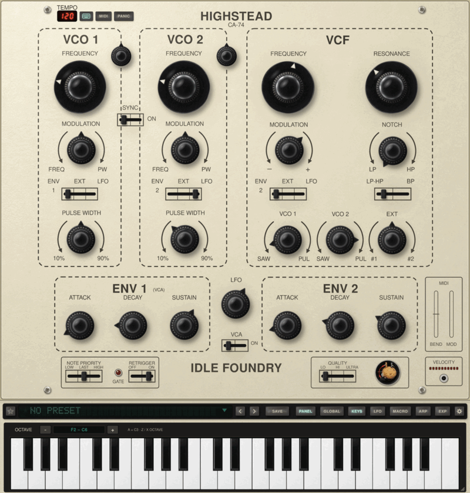
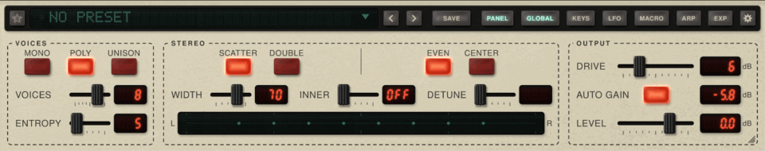

# Highstead

### The classic SEM circuit, free and open-source

**Highstead (CA-74)** is Idle Foundry’s free, open-source synthesizer modelled from the
Oberheim SEM’s circuit. Play one voice like the original module, a whole module for each
note in POLY, or a stack of voices in UNISON.

**macOS · Windows · Linux** &nbsp; | &nbsp; **VST3 · CLAP · Audio Unit on macOS · Standalone**

**[Download Highstead](https://github.com/idlefoundry/highstead/releases/latest)** ·
[Quick start](docs/quick-start.md) ·
[What’s new in 0.1.2](https://github.com/idlefoundry/highstead/releases/tag/v0.1.2) ·
[Official website & audio demos](https://www.idlefoundry.com/highstead)

  

## A circuit model, with room to play

The SEM-1A schematic was transcribed into SPICE netlists and simulated in ngspice. Highstead’s
real-time voice was derived from those simulations and tested against them, including the
factory calibration.

- **Two oscillators:** sawtooth and pulse waves, hard sync, pulse-width modulation and fine tuning.
- **The SEM filter:** a 12 dB/octave state-variable filter, sweeping from low-pass through notch
  to high-pass, with a separate band-pass mode.
- **The complete voice:** two envelopes, an LFO and a VCA, with the module’s familiar controls.
- **MONO, POLY and UNISON:** up to 10 voices, with ENTROPY for small differences between parts
  and slow oscillator drift.
- **Stereo and saturation:** SCATTER placement, DOUBLE and DETUNE, WIDTH and INNER, plus up to
  24 dB of DRIVE into the filter with AUTO GAIN compensation.
- **Expression:** MPE, pitch bend, aftertouch and MIDI Learn. MPE’s pressure and timbre amounts
  start at zero, ready to set for your controller.
- **Sounds and workflow:** factory basses, leads, brass, pads, percussion and effects; searchable
  presets, tags, favourites and your own saved sounds.
- **An interface you can adjust:** resizable window, larger lettering and custom `.ifskin`
  packs. The standalone application also has a playable keyboard and computer-keyboard input.

*A whole module for each note, with voice, stereo and output controls beneath the panel.*

## Download and install

**Current release: [Highstead 0.1.2](https://github.com/idlefoundry/highstead/releases/tag/v0.1.2).**
Choose the download for your computer:

| System | Download | Included formats |
| --- | --- | --- |
| macOS 11 or later, Apple silicon or Intel | [macOS installer (.pkg)](https://github.com/idlefoundry/highstead/releases/download/v0.1.2/Highstead-0.1.2-macOS.pkg) | VST3, CLAP, Audio Unit, standalone |
| Windows 10 or 11, 64-bit | [Windows installer (.exe)](https://github.com/idlefoundry/highstead/releases/download/v0.1.2/Highstead-0.1.2-Windows-setup.exe) | VST3, CLAP, standalone |
| Linux x86-64, Ubuntu 22.04 or equivalent or later | [Linux archive (.tar.gz)](https://github.com/idlefoundry/highstead/releases/download/v0.1.2/Highstead-0.1.2-Linux-x86_64.tar.gz) | VST3, CLAP, standalone |

For manual Windows installation, use the [Windows ZIP](https://github.com/idlefoundry/highstead/releases/download/v0.1.2/Highstead-0.1.2-Windows-x86_64.zip)
and follow its `README.txt`.

1. Close your DAW or host before installing or updating.
2. Run the installer. On Linux, unpack the archive and run `./install.sh` inside its folder.
3. Restart your host and rescan its plug-ins. Load **Highstead** as an instrument by **Idle Foundry**.
4. To play without a DAW, open the standalone application and choose **Settings › AUDIO & MIDI…**.

The macOS installer is **signed and notarised**. The Windows installer is **unsigned** and may
trigger SmartScreen. Download from this repository’s releases and check the
[SHA-256 checksums](https://github.com/idlefoundry/highstead/releases/download/v0.1.2/SHA256SUMS.txt).
Installing 0.1.2 over 0.1.1 keeps existing presets and saved sessions compatible.

**Performance:** LO is the lighter default quality; HI uses the circuit model; ULTRA is intended
for rendering or a small number of live voices. More voices and DOUBLE need more CPU. There is
no published minimum CPU specification yet, so real-time voice counts depend on your computer,
host and audio buffer. Lower LEVEL for dense chords.

## New in 0.1.2

- **Musical tuning readouts:** hover FREQUENCY for a semitone offset and FINE for cents.
  Tuning remains continuous, and existing presets and automation are unchanged.
- **Complete interface packs:** `.ifskin` packs can customise the panel, stereo strip, keyboard
  case and preset browser, including fonts and panel height. Packs contain artwork and data;
  they do not change the sound.
- **Easy manual skin installation:** open **Settings › LOOK › OPEN SKINS FOLDER…**, copy in a
  pack, then reopen LOOK and choose it.

Read the [full release notes](https://github.com/idlefoundry/highstead/releases/tag/v0.1.2)
for details. The source archive includes `docs/skin-packs.md` and a CC0 starter for making packs.

## Get started

Open the preset browser by clicking the preset name, choose a sound and play. For a fresh
patch, choose **INIT**. Try POLY for chords, UNISON for a stack, and WIDTH for stereo placement.

The [quick start](docs/quick-start.md) covers your first patch, expression, MIDI Learn and
saving sounds. The source archive’s `README.md` has the full control reference, installation
paths, calibration choices and known limitations.

The standalone application also supports optional local AI-agent control through MCP.
It is off until you choose **Settings › AGENTS › ALLOW**; setup and tool documentation are
in `docs/mcp.md` in the source archive. Agents reach the standalone application, not a plug-in
inside a DAW.

## Source, licence and documentation

This repository hosts the public downloads and product documentation. The implementation
repository is maintained separately; each release publishes its corresponding source.

- [Highstead 0.1.2 source and documentation](https://github.com/idlefoundry/highstead/releases/download/v0.1.2/Highstead-0.1.2-source.tar.gz)
- [Git-pinned dependency sources](https://github.com/idlefoundry/highstead/releases/download/v0.1.2/Highstead-0.1.2-git-sources.tar.gz)
- [Third-party notices](https://github.com/idlefoundry/highstead/releases/download/v0.1.2/THIRD-PARTY-NOTICES.txt)
- [Checksums](https://github.com/idlefoundry/highstead/releases/download/v0.1.2/SHA256SUMS.txt)
- [All releases](https://github.com/idlefoundry/highstead/releases)

**For the instrument’s source, use the explicitly named archives above.** GitHub’s automatic
“Source code” ZIP and tar.gz links contain this downloads repository, not the synthesizer’s
implementation. The 0.1.2 implementation source is from commit
`62c57c22752e5b0c2a4fd2c848f321837031c7d5`.

Highstead and its official artwork are free software under **[GPL-3.0-or-later](LICENSE)**.
Copyright © 2026 Idle Foundry Ltd. [Image provenance](docs/images/README.md).

## Feedback

[Report an issue](https://github.com/idlefoundry/highstead/issues) with your Highstead version,
OS, DAW and version (or standalone), plug-in format, quality mode and steps to reproduce it.
For audio problems, include the preset, sample rate, buffer size and voice settings where possible.

Oberheim and SEM are trademarks of their owner. Highstead is not affiliated with, sponsored or
endorsed by Oberheim or its owners. These names identify the published circuit the model was
derived from. VST is a registered trademark of Steinberg Media Technologies GmbH.
