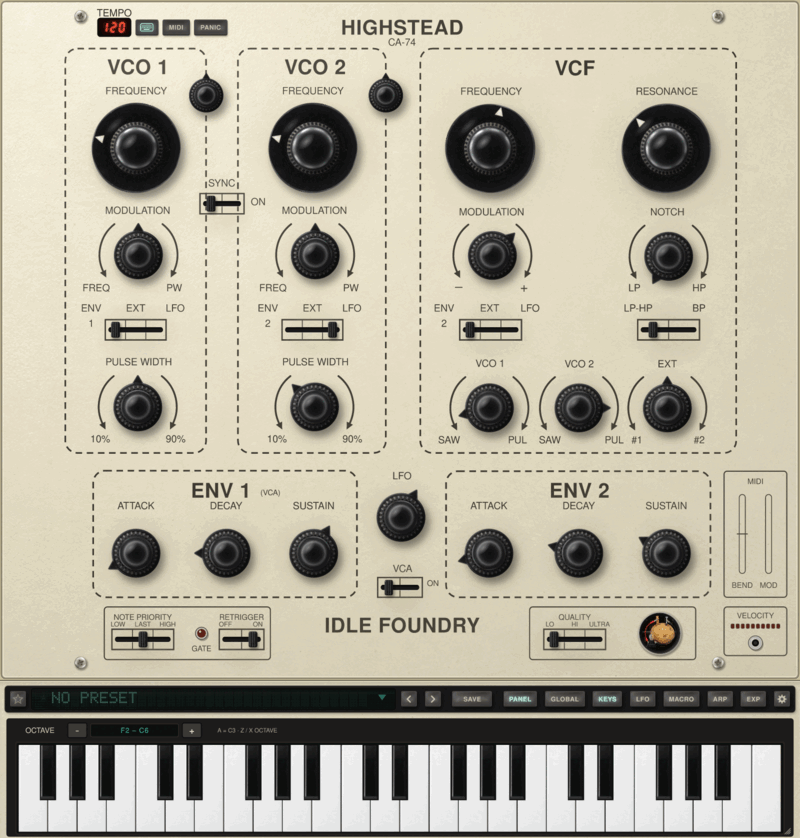
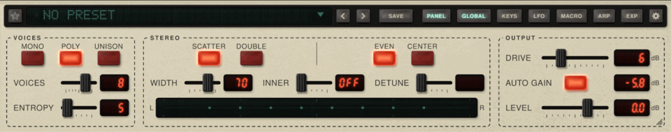

# Highstead quick start

[← Back to Highstead](../README.md) · [Download](https://github.com/idlefoundry/highstead/releases/latest)

Highstead models a SEM voice: two oscillators, a mixer, a state-variable filter,
two envelopes, the module’s LFO and a VCA. Around that voice are MONO, POLY and UNISON,
stereo placement, DRIVE, presets and a playable keyboard.

## Play

Load Highstead as a VST3, CLAP or Audio Unit instrument and send MIDI to it, or open
the standalone application and choose **Settings › AUDIO & MIDI…**. Show the playable
keyboard from the rail below the panel and click a key to play. In the application,
**TYPING** at the panel’s top left uses the computer’s keys. **PANIC** releases every note.

If the print is small, choose **Settings › LETTERING › LARGE**, LARGER or LARGEST.
**WINDOW › SIZE…** and the grip at the bottom right change the window’s size.

## Make your first patch

Click the preset name and choose **INIT**. Play a note. The default sound mixes
VCO 1’s sawtooth with VCO 2’s pulse, a little above it, through the low-pass filter.

1. Turn each VCO’s **FREQUENCY** to transpose it. Hover FREQUENCY for its pitch offset
   in semitones, or FINE for cents. The default EVEN law gives four octaves over the
   knob’s travel, with A4 at 440 Hz a quarter of the way round and 880 Hz at noon.
2. Balance the mixer’s **VCO 1** and **VCO 2**. Left is sawtooth, right is pulse and
   centre is off.
3. Lower the VCF’s **FREQUENCY** for a darker sound and raise **RESONANCE** for a peak.
4. Turn **NOTCH** from LP through notch to HP, or choose BP on the **LP-HP | BP** slide.
5. Shape loudness with ENV 1’s ATTACK, DECAY and SUSTAIN. ENV 2 can sweep the filter.

For vibrato, choose **LFO** on a VCO’s modulation source and turn MODULATION left
(FREQ), or raise the modulation wheel. Turning MODULATION right gives pulse-width
modulation. The module’s LFO rate knob sits between the envelopes. **SYNC** gives
oscillator hard sync.

## Play chords or a stack

In the lower panel, choose **POLY** for a whole module per note or **UNISON** for all
voices on one note. **VOICES** sets the count, from 2 to 10. **ENTROPY** gives the
voices’ parts small differences.

**SCATTER**, WIDTH and INNER place voices across the stereo field. **DOUBLE** plays
each note twice, DETUNE apart. Lower LEVEL for dense chords and use LO quality when
you need more CPU headroom. HI uses the circuit model; ULTRA is intended for rendering.

## Expression and MIDI Learn

**Settings › MPE…** holds MPE input mode, timbre rest and four expression amounts.
Pressure and timbre can each move modulation and cutoff, per note. They start at zero.
Ordinary pitch bend, mod wheel and aftertouch remain available.

Right-click a control, choose **MIDI LEARN**, then move a controller. Its next movements
operate that control. The MIDI assignments list also reaches controls without a face
control. MIDI Learn accepts absolute 7-bit control changes.

To type a knob value, Command-click it on macOS or Ctrl-click it elsewhere, then press
Enter. Double-click a numeric readout in the lower strip to type its value.

## Presets and output

Click the preset name to browse the factory sounds. Use tags and FIND, star favourites,
and SAVE your own sounds. A preset keeps the sound and expression amounts; your MIDI
assignments and device choices remain yours. INIT restores a fresh sound.

Watch the output meter and lower LEVEL if it reaches red. DRIVE adds saturation;
AUTO GAIN compensates its loudness, but compensation can be less exact at high DRIVE.
If a note sticks in the standalone application, use **PANIC** at the panel’s top left.

## Go further

The [corresponding source archive](https://github.com/idlefoundry/highstead/releases/download/v0.1.2/Highstead-0.1.2-source.tar.gz)
includes the complete control reference and limitations in `README.md`, plus
`docs/skin-packs.md` for custom interfaces and `docs/mcp.md` for local agent integration.

Adapted from the quick start and control reference shipped with Highstead 0.1.2.
Copyright © 2026 Idle Foundry Ltd. [GPL-3.0-or-later](../LICENSE).
